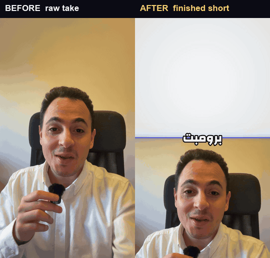
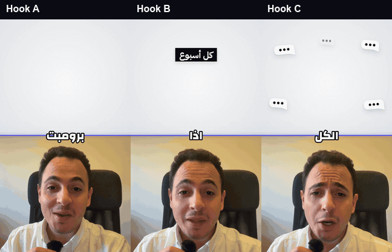
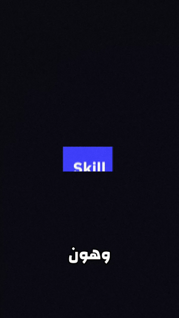
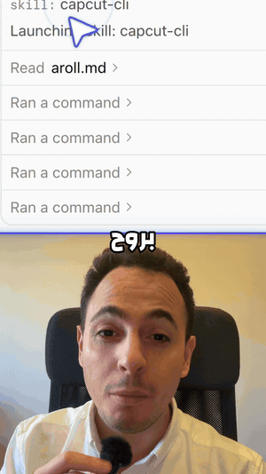

# capcutctl

[](https://github.com/RoXsaita/capcut-editor-cli/actions/workflows/ci.yml)
[](https://github.com/RoXsaita/capcut-editor-cli/releases)
[](LICENSE)

**Your AI agent edits real CapCut projects, and they stay editable.**

Hand a coding agent (Claude Code, Codex, any agent with a shell) a raw talking-head take and a
screen recording. Through `capcutctl` it cuts the A-roll, lays out the shots, adds captions,
motion graphics and sound, checks the result, and hands you back a **native CapCut project**.
Every clip, mask, keyframe and caption is still there to change by hand.

macOS · CapCut Desktop · Node 20+ · MIT · unofficial, not affiliated with ByteDance or CapCut

<p align="center">
  
</p>
<p align="center"><sub>The same 4 seconds. Left: the raw take. Right: the finished short an agent built from it with capcutctl.</sub></p>

<!-- Sections below are additive and self-contained so a rebase can resolve them one at a time. -->

## See it on a real video

This short was edited end to end by Claude Code agents with `capcutctl` and the
[capcut-skills](https://github.com/RoXsaita/capcut-skills), then posted. It is in Levantine Arabic;
the captions are the ones the edit shipped with.

<p align="center">
  <a href="https://www.youtube.com/watch?v=ZZ6nCUMYYPE"></a><br>
  <sub><b>▶ Prompt vs skill vs agent</b> · <a href="https://www.youtube.com/watch?v=ZZ6nCUMYYPE">YouTube</a> · <a href="https://www.instagram.com/reel/DeuTTy2n1i3/">Instagram</a> · posted 2026-10-20</sub>
</p>

| | Before | After |
|---|---|---|
| Footage | one 157.7 s face take (two attempts, retakes inside) + screen recordings | a 57.7 s 1080×1920 short |
| Talking head | 40 spoken beats, repeated lines, dead air | the last clean take of each line, cut on acoustic boundaries (`capcutctl cut`) |
| Picture | a person talking to camera | split screens, full-frame scenes with a circle PiP, proof shots from the real session |
| Text | none | 113 editable word-by-word caption clips |
| Checks | none | `doctor` 0 errors; the draft `gate` passed with warnings and no FAIL; the export measures −14.3 LUFS |
| In CapCut | | still a native project: open it and move, retime or delete anything |

### More from the same edit

| Three openings, one edit | A scene on a word | Proof from the real session |
|---|---|---|
|  |  |  |
| Hook A is the main post. Hooks [B](https://www.instagram.com/reel/DeuTcbxiGGj/) and [C](https://www.instagram.com/reel/DeuTlEKlAJt/) went out as Instagram trial reels. [`capcutctl variant`](docs/guide.md#hook-variants-for-trial-reels) makes such a duplicate from a signed-off edit in one command. | Motion graphics are rendered with alpha and placed on the spoken word, so a recut moves them with the word. See [docs/mograph.md](docs/mograph.md). | The screen recording plays at 1× in a split, punched in so the text reads on a phone. |

## Why it is different

- **The project stays editable.** `capcutctl` writes CapCut's own draft files. Clips remain
  clips, layouts are transforms and masks, captions are text clips, and audio changes are
  timeline edits. Nothing is flattened into a rendered video, so you can finish the edit by hand.
- **Every edit is a transaction.** Each write snapshots the project, applies the change to both
  of CapCut's live documents, validates media, ids, timing and overlaps, syncs the mirror
  files, and rolls back if the result does not pass. Every edit command takes `--dry-run`.
  With `stage`, an agent edits a copy while CapCut stays open.
- **It checks its own work.** `gate` is a ready-to-post check with three levels: **FAIL**
  blocks, **WARN** must be named in the hand-off, **NOTE** is informational. It covers the
  hook, proof on screen, dead stretches, crowding and platform safe zones. `xray` measures every
  frame and audio sample of an export (black and frozen frames, flashes, dead air, loudness,
  true peak), and `check-export` is the last check before posting.
- **It is built for agents.** A machine-readable [contract](docs/cli-contract.json) describes
  every command and option. The companion skills are checked against it in CI, so an agent's
  instructions cannot drift from the real CLI. Your brand lives in your own profile, outside
  both repositories.

## How it works

1. **Record.** One talking-head take and the screen recordings that prove what you say.
2. **Ask your agent.** With the [capcut-skills](https://github.com/RoXsaita/capcut-skills)
   installed, the agent asks which style to use, proposes an A-roll cut for you to sign off,
   writes a shot list and an `edit.json` plan, runs `capcutctl build`, and stops on a
   failing `gate`.
3. **Open it in CapCut.** Review, tweak anything by hand, and export.

## Quick start (about 5 minutes)

You need macOS with CapCut Desktop installed and opened once, plus Homebrew.

```bash
brew install node python@3.11 ffmpeg

git clone https://github.com/RoXsaita/capcut-editor-cli.git
cd capcut-editor-cli
npm link                                   # puts capcutctl on your PATH
python3.11 -m venv .venv
.venv/bin/python -m pip install -e .       # NumPy and Pillow for qa, find and preview

capcutctl preflight                        # checks every dependency and names the fix
capcutctl projects                         # lists your CapCut drafts
```

Try a safe, read-only look at one of your projects, then a dry run that writes nothing:

```bash
capcutctl doctor   --project "My Edit"
capcutctl timeline --project "My Edit"
capcutctl layout split-screen --project "My Edit" --at 12.5 --track 2 --dry-run
```

To let an agent do the whole edit, install the skills
([steps](https://github.com/RoXsaita/capcut-skills/blob/main/CONTRIBUTING.md#install)) and ask
it, for example: *"Use the capcut-editing skill to edit `~/Movies/face.mp4` and
`~/Movies/screen.mov` into a short."* It will ask about style before the first write.

Motion graphics need Playwright's Chromium, and transcription for `cut` is a separate install.
[SETUP.md](SETUP.md) covers both, plus the companion skills and what will not work on a new Mac.

## Commands

<!-- COMMANDS:BEGIN generated by scripts/render-docs.mjs from docs/cli-contract.json; do not edit by hand -->

78 commands (CLI 0.1.1, contract v2). **T** marks a transactional edit: snapshot, validate, roll back on failure, and `--dry-run`.

| Stage | Commands |
|---|---|
| [Start and inspect](docs/commands.md#start-and-inspect) | `close`, `contract`, `inspect`, `new` **T**, `preflight`, `profile`, `projects`, `scenes`, `status`, `timeline`, `version`, `help` |
| [Talking head (A-roll)](docs/commands.md#talking-head-a-roll) | `cut`, `ripple` **T** |
| [Screen recordings (B-roll)](docs/commands.md#screen-recordings-b-roll) | `add` **T**, `fade` **T**, `find`, `localize` **T**, `match` **T**, `remove` **T**, `replace-media` **T**, `shift` **T**, `split` **T**, `trim` **T**, `verify-shots`, `volume` **T** |
| [Layouts and picture](docs/commands.md#layouts-and-picture) | `blur-broll` **T**, `grade` **T**, `layout` **T**, `reframe` **T** |
| [One-pass build](docs/commands.md#one-pass-build) | `build` **T**, `variant` **T** |
| [Camera and pace](docs/commands.md#camera-and-pace) | `cursor` **T**, `keyframe` **T**, `pace` **T**, `punch` **T**, `ramp` **T**, `screen-motion` **T**, `zoom` **T** |
| [Graphics and text](docs/commands.md#graphics-and-text) | `animate` **T**, `brands`, `captions` **T**, `endcard` **T**, `ending` **T**, `logo` **T**, `mograph` **T**, `motion` **T**, `sfx` **T**, `wrap` **T** |
| [Seams, music and mix](docs/commands.md#seams-music-and-mix) | `denoise` **T**, `finish` **T**, `loudness` **T**, `music` **T**, `polish` **T** |
| [Check and review](docs/commands.md#check-and-review) | `alpha`, `check-export`, `diff`, `doctor`, `gate`, `preview`, `qa`, `reference`, `review`, `review-video`, `xray` |
| [Snapshots and repair](docs/commands.md#snapshots-and-repair) | `apply` **T**, `history`, `init-spec`, `notes`, `restore` **T**, `rm` **T**, `snapshot`, `stage` **T**, `sync` **T** |
| [Export (explicit request only)](docs/commands.md#export-explicit-request-only) | `export`, `export-grid` |
| [Development](docs/commands.md#development) | `harvest`, `oracle` |

Every command with its purpose, an example and every option: [docs/commands.md](docs/commands.md).

<!-- COMMANDS:END -->

`capcutctl help` prints the full help text, and `capcutctl contract` prints the same surface as
JSON. After changing a command, refresh the contract and these docs:

```bash
capcutctl contract > docs/cli-contract.json
node scripts/render-docs.mjs
```

## The toolkit

| Piece | What it does |
|---|---|
| `capcutctl` (this repo) | Reads and writes CapCut drafts transactionally: cut, layout, graphics, captions, sound, gate, QA. |
| [capcut-skills](https://github.com/RoXsaita/capcut-skills) | The agent's instructions: `capcut-editing` (the whole procedure, start here), `capcut-cli` (the rules and the generated command reference), `capcut-motion` (motion design with taste). They land in lockstep with this CLI and are validated against its contract. |
| rl2 (the recorder, not public yet) | Records the screen with an interaction trace: cursor path and clicks. `capcutctl cursor` turns that telemetry into editable cursor halos and click ripples, and `find --moments` uses it to locate what happened when. |

## Documentation

- [Guide](docs/guide.md): build and gate, motion graphics, captions, stage and swap,
  `doctor --fix`, hook variants, common workflows, A-roll and visual QA, the native export
  bridge.
- [Command reference](docs/commands.md): every command, an example and every option,
  generated from [the contract](docs/cli-contract.json).
- [SETUP.md](SETUP.md): a new Mac from zero, with the skills.
- [Motion graphics](docs/mograph.md), [the follow ending](docs/ending.md),
  [native captions](docs/native-captions.md), [screen motion](docs/screen-motion.md).
- [Release process](docs/PRE-PUBLISH.md).

### Editing model

CapCut keeps a root draft and an active timeline as separate authoritative documents.
`capcutctl` applies the same operation to both rather than copying one over the other, and every
committed transaction snapshots, validates, syncs `draft_info.json` with its backup and
temporary mirrors, and restores the snapshot if the post-write check fails. The eight steps, and
why media must stay full-frame and durable, are in the
[guide](docs/guide.md#editing-model).

### Presets and machine-local resources

Layout artwork ships in `assets/`. CapCut effect and sound ids do not: CapCut creates them when
you download those resources on your Mac, so missing SFX are reported and skipped. Logos are
not bundled. Your brand, styles and preferences live in your own profile
(`capcutctl profile init`), outside the repository. Details:
[guide → Presets and machine-local resources](docs/guide.md#presets-and-machine-local-resources).

## Status

The current release is **v0.1.1**, an early public release used on real CapCut projects, with
300+ automated tests around transactions, rollback, media provenance, layouts, A-roll and clean
installation.

CapCut's draft format is undocumented and may change. Work on a copy of an important project
until you trust the workflow on your CapCut version. Transactions reduce the risk; they cannot
make an unofficial file format stable.

## Development

Development commands assume a Git clone. Install the quality tools and build the macOS OCR
helper as described in [CONTRIBUTING.md](CONTRIBUTING.md).

```bash
./scripts/check.sh --strict
```

That runs JavaScript syntax checks, the Node test suite, Python self-tests and compilation,
Ruff, Vulture, ShellCheck, and checks that the macOS Vision OCR helper is built. Tests use
temporary synthetic projects and do not edit your CapCut library. CI runs on Node.js 20 and 24
with Python 3.11. The advisory AI reviewer is documented in
[`.github/AUTOMATION.md`](.github/AUTOMATION.md).

The landing page is [`site/`](site/index.html): one static HTML file and its media, no build step.

## Contributing

Forks and focused pull requests are welcome. Start with [CONTRIBUTING.md](CONTRIBUTING.md),
keep each PR to one job, and include the smallest test that proves a non-trivial change.
Report bugs in the [issue tracker](https://github.com/RoXsaita/capcut-editor-cli/issues).

## License and disclaimer

MIT licensed. See [LICENSE](LICENSE) and [NOTICE](NOTICE).

This project is unofficial and is not affiliated with, endorsed by, or sponsored by ByteDance,
CapCut, or Lemon Inc. It reads and writes local CapCut project files. CapCut, its effects,
fonts, sounds, and project format belong to their respective owners. Use of this software with
CapCut remains subject to CapCut's terms and to the laws that apply to you.

The example videos and stills are © Suheil Abu Aittah and are included to show what the tool produces; they are not covered by the MIT license.
